# Evidencias — Laboratorio 2: FRRouting con un solo router

Cada sección indica los comandos a ejecutar en la VM (Bash), qué debe verse en la captura y el nombre exacto con el que se guarda la imagen en `evidencias/`.

## Lista de verificación

| N.º | Imagen | Ejercicio |
|---|---|---|
| 1 | `01-entorno.png` | 2 |
| 2 | `02-frr-instalado.png` | 3 |
| 3 | `03-demonios-version.png` | 4 |
| 4 | `04-rutas-base.png` | 4 y 5 |
| 5 | `05-dummy0-conectada.png` | 6 y 7 |
| 6 | `06-blackhole-frr-kernel.png` | 8 y 9 |
| 7 | `07-config-guardada.png` | 10 y 11 |
| 8 | `08-eliminar-restaurar.png` | 12 |
| 9 | `09-descarte.png` | 13 |
| 10 | `10-interfaz-contadores.png` | 14 |
| 11 | `11-logs.png` | 15 |
| 12 | `12-ospf-sin-vecinos.png` | 16 |
| 13 | `13-persistencia.png` | pregunta 4 |

---

## 1. Entorno (Ejercicio 2)

```bash
clear
head -4 /etc/os-release
uname -r
whoami
ip -br addr
ip -4 route
ps -p 1 -o comm=
```

**Debe verse:** Ubuntu 26.04.1 LTS, el kernel, el usuario, `enp0s3` con `10.0.2.15/24`, la ruta `default via 10.0.2.2` y `systemd`.

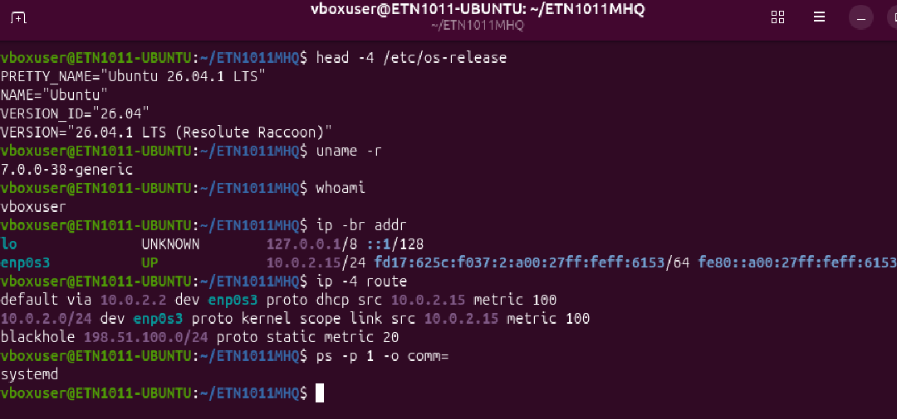

---

## 2. FRR instalado (Ejercicio 3)

```bash
clear
apt policy frr | head -3
sudo systemctl status frr --no-pager | head -16
```

**Debe verse:** versión `10.5.1-1ubuntu4.1`, servicio `active (running)` y `watchfrr` supervisando `mgmtd`, `zebra` y `staticd`.

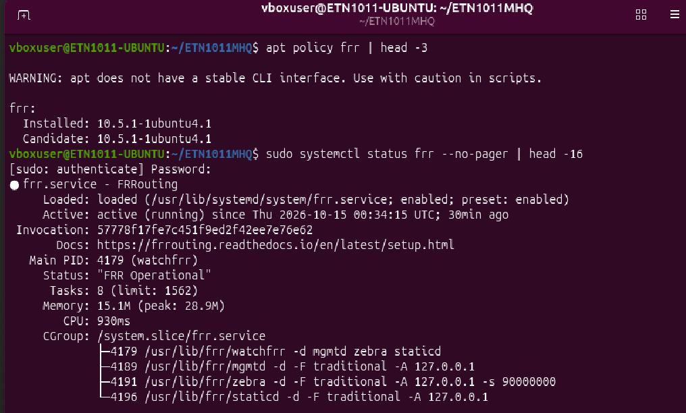

---

## 3. Demonios y versión (Ejercicio 4)

```bash
clear
sudo grep -E '^(bgpd|ospfd)=' /etc/frr/daemons
sudo grep -n -i "always started" /etc/frr/daemons
sudo vtysh -c 'show version' | head -2
```

**Debe verse:** `bgpd=no`, `ospfd=no`, la línea que indica que `watchfrr`, `zebra` y `staticd` siempre arrancan, y la versión de FRR.

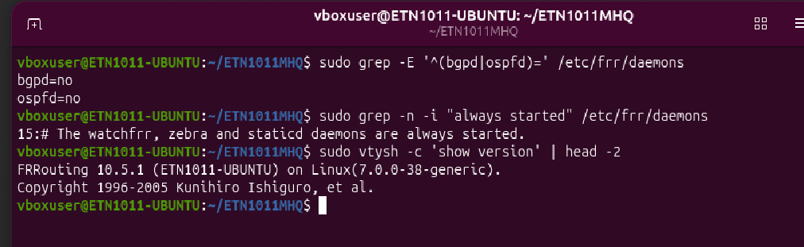

---

## 4. Rutas base y OSPF apagado (Ejercicios 4 y 5)

```bash
clear
sudo vtysh -c 'show ip route'
sudo vtysh -c 'show ip ospf neighbor'
```

**Debe verse:** rutas `K` (default), `C` y `L` de `enp0s3`, y el mensaje `ospfd is not running`.

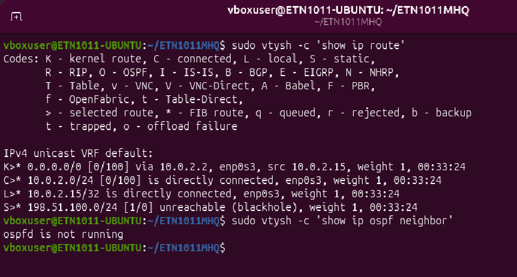

---

## 5. Interfaz `dummy0` y ruta conectada (Ejercicios 6 y 7)

```bash
clear
sudo ip link add dummy0 type dummy
sudo ip addr add 10.10.10.1/24 dev dummy0
sudo ip link set dummy0 up
ip -br addr show dummy0
ip -4 route show 10.10.10.0/24
sudo vtysh -c 'show ip route connected'
```

**Debe verse:** `dummy0` con `10.10.10.1/24`, la ruta conectada del kernel y `C>* 10.10.10.0/24 ... dummy0` en FRR.

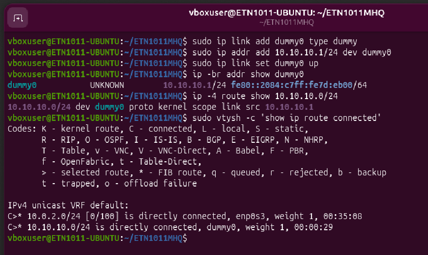

---

## 6. Ruta `blackhole`: vista de FRR y del kernel (Ejercicios 8 y 9)

```bash
clear
sudo vtysh -c 'show ip route 198.51.100.0/24'
ip -4 route show 198.51.100.0/24
```

**Debe verse:** en FRR `Known via "static", distance 1` y `unreachable (blackhole)`; en el kernel `blackhole 198.51.100.0/24 proto static metric 20`.

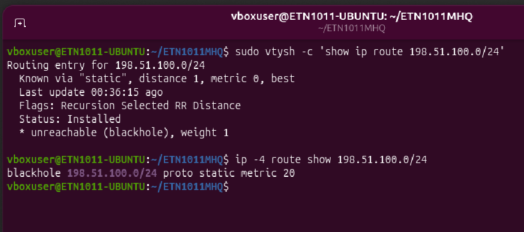

---

## 7. Configuración activa y guardada (Ejercicios 10 y 11)

```bash
clear
sudo vtysh -c 'show running-config'
sudo vtysh -c 'show ip route static'
sudo vtysh -c 'write memory'
sudo grep -n "198.51.100.0" /etc/frr/frr.conf
```

**Debe verse:** `ip route 198.51.100.0/24 blackhole` en la configuración, la ruta con código `S`, el mensaje `[OK]` de `write memory` y la línea encontrada en `frr.conf`.

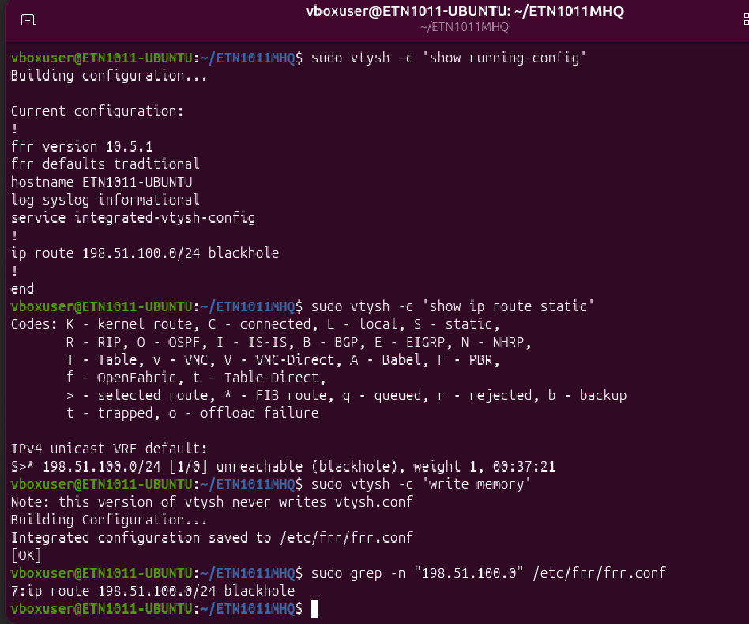

---

## 8. Eliminar y restaurar la ruta (Ejercicio 12)

```bash
clear
sudo vtysh -c 'configure terminal' -c 'no ip route 198.51.100.0/24 blackhole' -c 'end' -c 'show ip route 198.51.100.0/24'
sudo vtysh -c 'configure terminal' -c 'ip route 198.51.100.0/24 blackhole' -c 'end' -c 'show ip route 198.51.100.0/24'
```

**Debe verse:** primero `% Network not in table` y después la ruta estática restaurada.

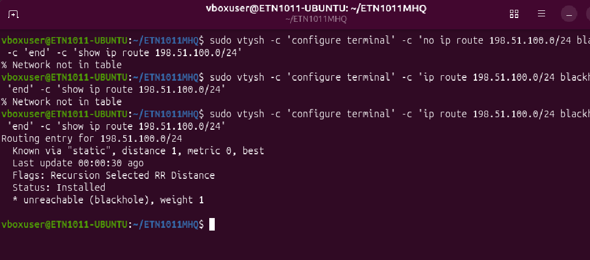

---

## 9. Comportamiento del descarte (Ejercicio 13)

```bash
clear
ip route get 198.51.100.10
ping -c 2 198.51.100.10
```

**Debe verse:** ambos comandos responden `Invalid argument` (el kernel rechaza el envío porque la ruta es de descarte).

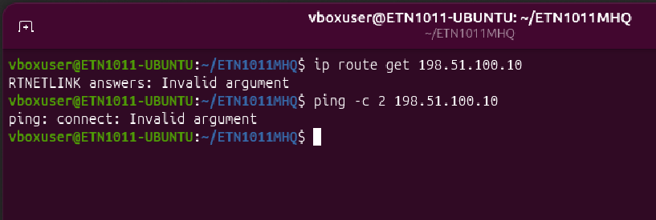

---

## 10. Estado y contadores de `dummy0` (Ejercicio 14)

```bash
clear
ip -s link show dummy0
sudo vtysh -c 'show interface dummy0'
```

**Debe verse:** contadores RX/TX en Linux y `Interface dummy0 is up, line protocol is up` en FRR.

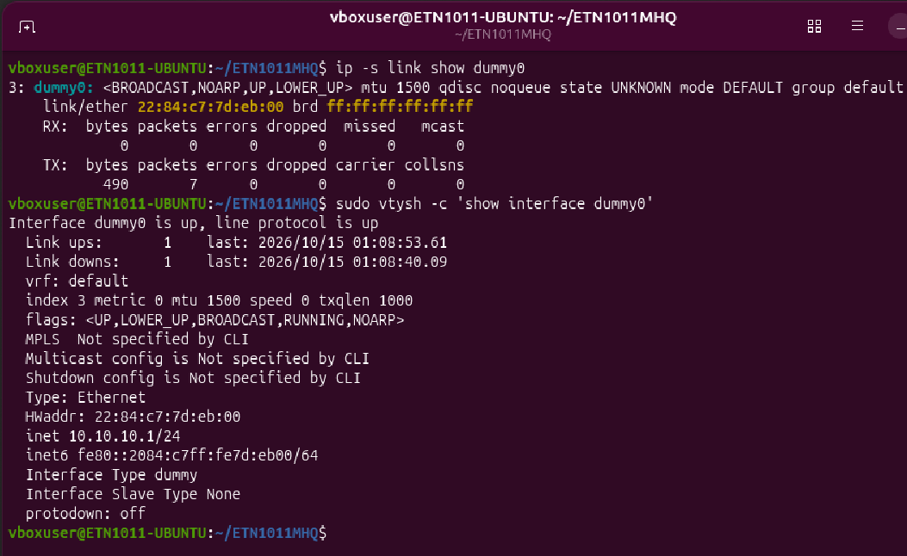

---

## 11. Diagnóstico con logs (Ejercicio 15)

```bash
clear
sudo systemctl status frr --no-pager | head -8
sudo journalctl -u frr -n 15 --no-pager
```

**Debe verse:** el servicio activo y las últimas líneas del log de `watchfrr`.

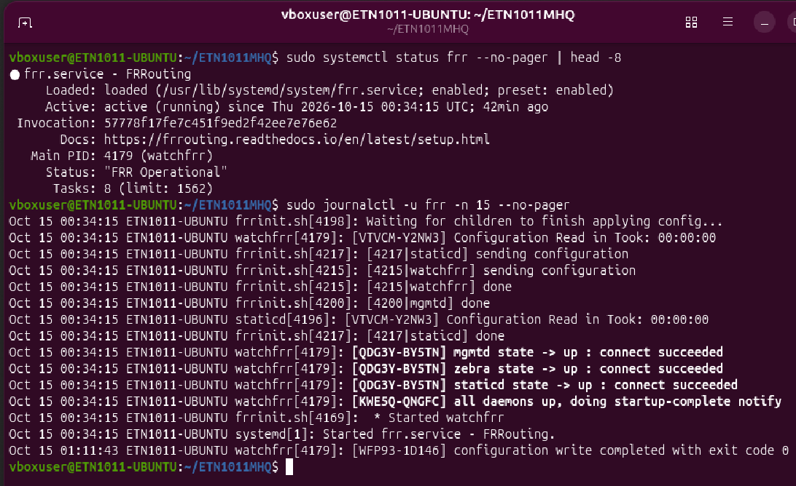

---

## 12. OSPF con un solo router (Ejercicio 16)

```bash
clear
sudo sed -i 's/^ospfd=no/ospfd=yes/' /etc/frr/daemons
sudo systemctl restart frr
sleep 5
sudo systemctl status frr --no-pager | grep -E 'Active|ospfd'
sudo vtysh -c 'configure terminal' -c 'router ospf' -c 'network 10.10.10.0/24 area 0' -c 'end' -c 'show ip ospf interface' -c 'show ip ospf neighbor'
```

**Debe verse:** `ospfd` entre los procesos, `dummy0` en el área 0 con `Neighbor Count is 0` y la tabla de vecinos vacía.

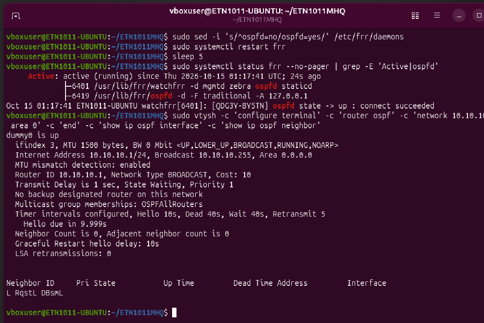

---

## 13. Persistencia tras reiniciar (pregunta 4 de evaluación)

Primero guarda y reinicia:

```bash
sudo vtysh -c 'write memory'
sudo reboot
```

Con la VM reiniciada, abre la terminal y ejecuta:

```bash
clear
ip link show dummy0
sudo vtysh -c 'show running-config'
```

**Debe verse:** `Device "dummy0" does not exist` (la interfaz creada con `ip link` no persiste), mientras que `ip route 198.51.100.0/24 blackhole` y `router ospf` siguen en la configuración (guardados con `write memory`).

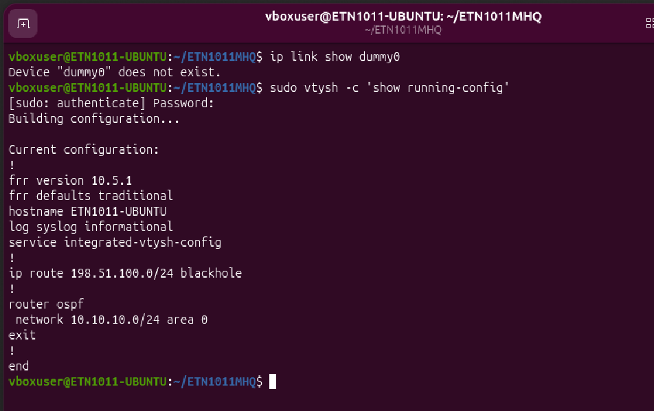

---

## Limpieza final (sección 9 de la guía)

No es una captura, pero deja el sistema como estaba.

```bash
sudo sed -i 's/^ospfd=yes/ospfd=no/' /etc/frr/daemons
sudo systemctl restart frr
```

`dummy0` ya no existe tras el reinicio.

```bash
sudo vtysh -c 'configure terminal' -c 'no ip route 198.51.100.0/24 blackhole' -c 'end' -c 'write memory'
```
